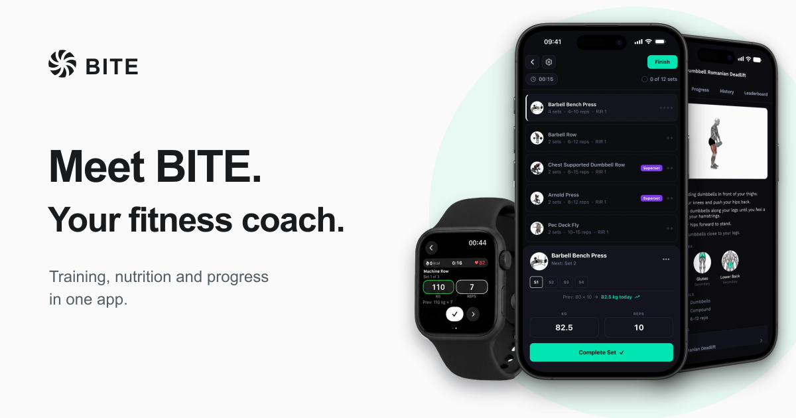

# Noah Nemhed Uppgren

Solo developer based in Malmö, Sweden. I design and build products across mobile, backend and web.

## BITE

I have spent the past 8–9 months building **BITE**, a fitness product that brings workout planning, logging, nutrition, progress and coaching together. I built the mobile app, Apple Watch companion, backend, internal admin console and marketing site as one connected product.

**[Explore the product](https://www.bitefitness.app/)** · **[View the App Store listing](https://apps.apple.com/app/id6770621331)** · **[Read the project case study](https://github.com/NoahNemhed/bite-case-study)**

The case study shows product screens, interactive marketing demos, the admin console, the high-level architecture and a conceptual data model. The application source remains private.

**What I work with:** React Native, Expo, TypeScript, Java, Spring Boot, PostgreSQL and Next.js.
